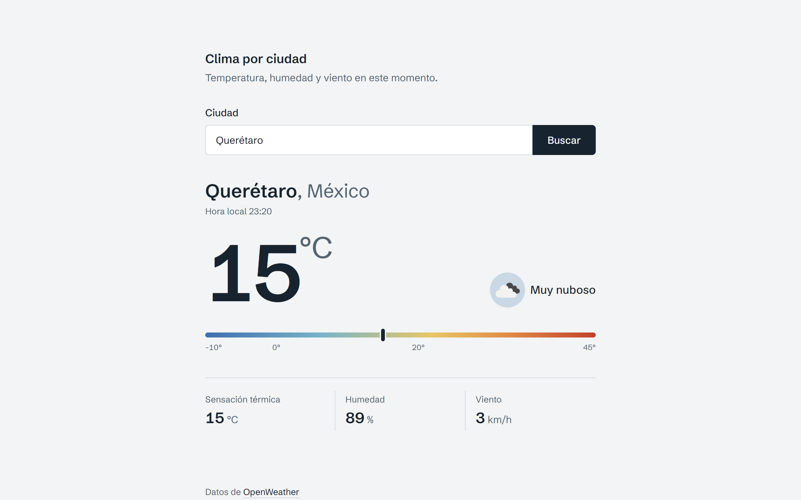
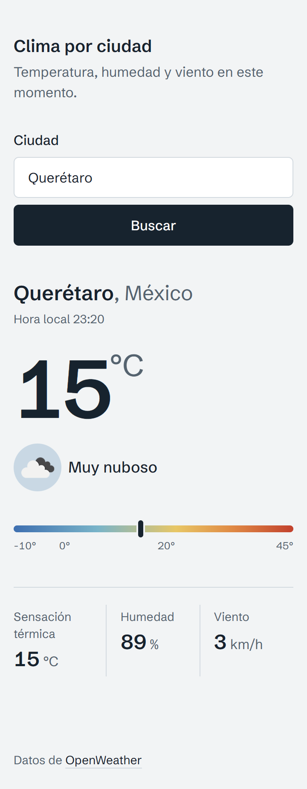

# Clima por ciudad

A small web app to check the current weather in any city. Type a city name and it shows the temperature, how it feels, humidity, wind and the local time, using data from [OpenWeather](https://openweathermap.org/).

The interface is in Spanish.

**Live demo:** [clima-por-ciudad.vercel.app](https://clima-por-ciudad.vercel.app)

## Screenshots

<p>
  
  &nbsp;
  
</p>

## What it does

- Search by city name, with the button or by pressing Enter.
- Shows the city and country, local time, temperature in °C (rounded), feels-like temperature, a short description with its icon, humidity and wind speed in km/h.
- A temperature scale from -10° to 45° so you can tell at a glance whether it's cold or hot.
- A few suggested cities on the first screen, so you can try it with one click.
- While a search is running, the button is disabled to avoid duplicate requests.
- Different messages for a city that doesn't exist and for connection or API errors.
- Empty searches are ignored, and extra spaces are trimmed before searching.
- Works from 360 px wide phones up to desktop, and can be used with the keyboard and screen readers.

## Built with

- [React](https://react.dev/) and [Vite](https://vite.dev/)
- [Tailwind CSS](https://tailwindcss.com/) v4
- [OpenWeather Current Weather API](https://openweathermap.org/current)
- Deployed on [Vercel](https://vercel.com/)

## Project structure

The API call lives in its own service, so the components only deal with displaying data.

```
src/
├── components/
│   ├── Loader.jsx            # Loading placeholder
│   ├── SearchForm.jsx        # Search input, validation and suggested cities
│   ├── StatusMessage.jsx     # "City not found" and error messages
│   ├── TemperatureScale.jsx  # Cold-to-hot scale
│   ├── WeatherCard.jsx       # Weather details for the city
│   └── WeatherStat.jsx       # A single value (humidity, wind...)
├── hooks/
│   └── useWeather.js         # Search state: loading, success, error
├── services/
│   └── weatherApi.js         # OpenWeather request and data mapping
├── App.jsx
└── main.jsx
```

## Running it locally

You'll need Node.js 20 or newer and a free API key from [OpenWeather](https://home.openweathermap.org/api_keys).

1. Clone the repo and install the dependencies:

   ```bash
   git clone https://github.com/Ash54398/clima-por-ciudad.git
   cd clima-por-ciudad
   npm install
   ```

2. Copy the example env file and add your API key:

   ```bash
   cp .env.example .env
   ```

   ```env
   VITE_OPENWEATHER_API_KEY=your_api_key
   ```

   New OpenWeather keys can take up to 2 hours to start working. Until then the app will show the connection error message.

3. Start the dev server:

   ```bash
   npm run dev
   ```

## Deploying to Vercel

1. Import the repository in Vercel. It detects Vite on its own.
2. Under **Settings → Environment Variables**, add `VITE_OPENWEATHER_API_KEY` with your key.
3. Deploy.

A note on the API key: since this is a frontend-only app, the key ends up in the JavaScript the browser downloads. That's fine here because it's a free, rate-limited key, but for a real product I'd move the request to a serverless function.

## Not included (yet)

Multi-day forecast, geolocation, switching between °C and °F, search history and weather-based backgrounds were left out of this first version on purpose.
